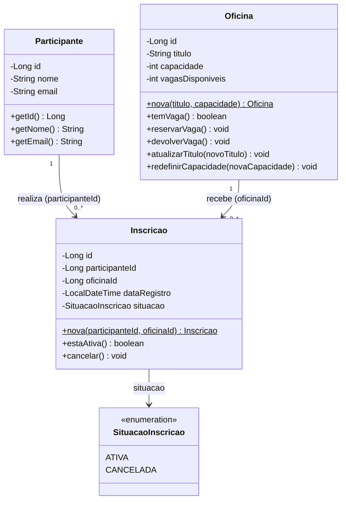
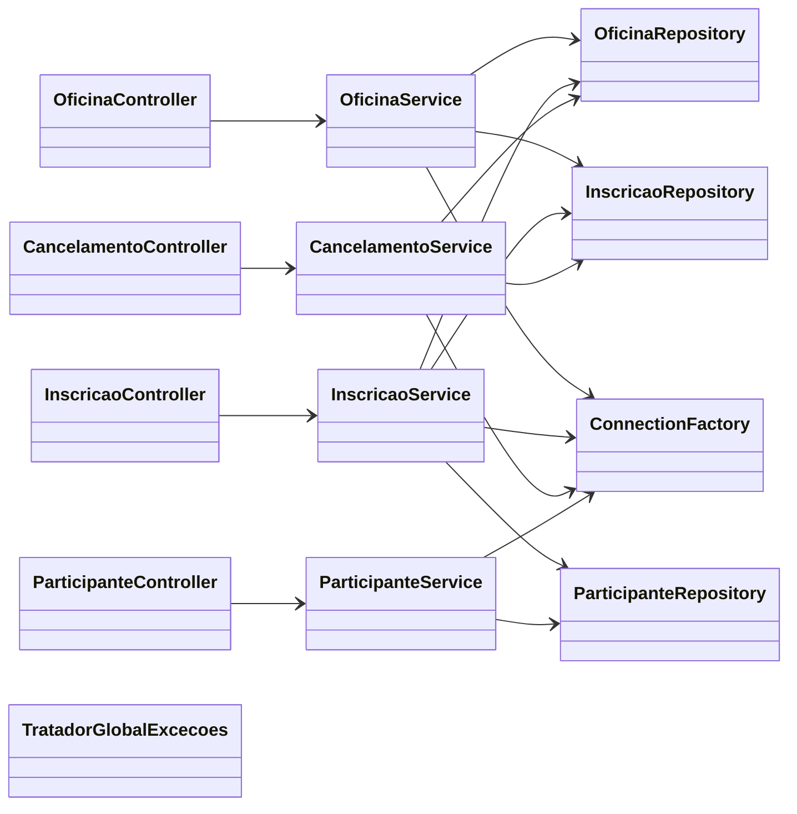

# Diagrama de classes (UML)

O diagrama abaixo é escrito em Mermaid: o GitHub o desenha automaticamente ao abrir este arquivo.
Para gerar uma imagem (exigida no README), cole o código em <https://mermaid.live> e baixe o PNG
para `docs/diagrama-classes.png`.

## Domínio

Notas de modelagem:

- A ligação entre `Inscricao`, `Participante` e `Oficina` é feita pelos identificadores (chaves
  estrangeiras do banco), por isso a associação é rotulada com o nome do atributo.
- `Oficina` protege a invariante `0 <= vagasDisponiveis <= capacidade`: os atributos são privados e só
  mudam por `reservarVaga`, `devolverVaga` e `redefinirCapacidade`.
- `Inscricao` funciona como histórico: `cancelar()` apenas muda a situação, nunca apaga o registro.

## Camadas e dependências

Fluxo: Postman/HTTP → Controller → Service → Repository → PostgreSQL.
O `TratadorGlobalExcecoes` traduz as exceções lançadas pelas camadas de baixo em códigos HTTP.
